<div align="center">

# 🔐 PASSWORD CRACKING REPORT

### Recovering Passwords from Protected PDF Files

**WEEK 3 | CYBERSECURITY | NETWORKWALKS**

</div>

<p align="center">
  
  
  
  
  
  
  
  
</p>

| Field | Detail |
|---|---|
| **Pentester Name (Cybersecurity Professional)** | Azlal Ahamed |
| **Program/Batch** | B084C-Networkwalks |
| **Date** | 18 November 2026 |
| **Modules completed** | W3-PM1 (Password Cracking with JTR)<br>W3-PM2 (Password Cracking with NetworkWalks Tools) |
| **Target files** | Networkwalks training PDFs (`My Locked PDF1.pdf`) provided by the program |
| **Permission secured?** | Yes – these are the program's own practice files, used on my own laptop |
| **Flags captured** | PM1: `nw{cybersecurity_flag_captured_2608}`<br>PM2: `nw{networkwalks_flag1_jtr_270521_1}` |

---

## 1. Liability Disclaimer

I performed these activities only on the training files provided by Networkwalks for this lab (`My Locked PDF1.pdf`) and only on my own laptop. Password cracking was done to understand how weak passwords are recovered and why strong passwords matter.

All materials here are for education and research purposes only. Do not use anything from here to break the law. Cracking or trying to open files, accounts or systems you do not own or have written permission for is illegal in most countries, even if nothing is damaged. The instructor, the author and Networkwalks are not responsible for misuse. Every action you take is your own responsibility.

---

## 2. Introduction

This report covers Week 3 of my Cybersecurity & Ethical Hacking internship at Networkwalks. The goal was to recover the password of a protected PDF file using two different approaches:

- **W3-PM2 – NetworkWalks online tools:** a browser-based Hash Calculator and Password Cracker (no installation).
- **W3-PM1 – John the Ripper (JTR):** the industry-standard password cracking tool, run on my Windows laptop.

Both modules use the same idea: a locked PDF stores its password as a **hash** (a scrambled value). To recover the password we first **extract the hash** from the file, then run a **dictionary attack** – trying many common passwords until one produces a matching hash.

> **Hashing vs Encryption:** Encryption is a two-way function (what is encrypted can be decrypted with the key). Hashing is a one-way function that scrambles input into a fixed digest and cannot be reversed – so cracking means guessing inputs until the hash matches, not "un-hashing".

Both target PDFs used **PDF encryption Revision 4, Version 4, 128-bit key** (shown by the hash tools).

---

## 3. Tools Used

| Tool | Purpose |
|---|---|
| NetworkWalks Hash Calculator (web) | Extract the `$pdf$...` hash from a locked PDF (parsed locally in the browser) |
| NetworkWalks Password Cracker (web) | Dictionary attack against the hash using a built-in / uploaded wordlist |
| John the Ripper 1.9.0-jumbo-1 (Windows) | Industry-standard password cracker (PDF format support is in the "jumbo" build) |
| `pdf2john` | Helper (included with JTR) that extracts a crackable hash from a PDF |
| rockyou.txt | Well-known wordlist of ~14 million leaked passwords, used as the dictionary |
| Windows Command Prompt | Running John and viewing the cracked password |

---

## 4. Activities Performed

### 4.1 W3-PM2 — Password Cracking with NetworkWalks Tools

**Step 1 – Extract the hash.** I opened the NetworkWalks Hash Calculator, chose the **PDF** tab and uploaded the locked PDF. The tool parsed the file locally and produced a `$pdf$...` hash (Revision R4, Version V4, 128-bit).

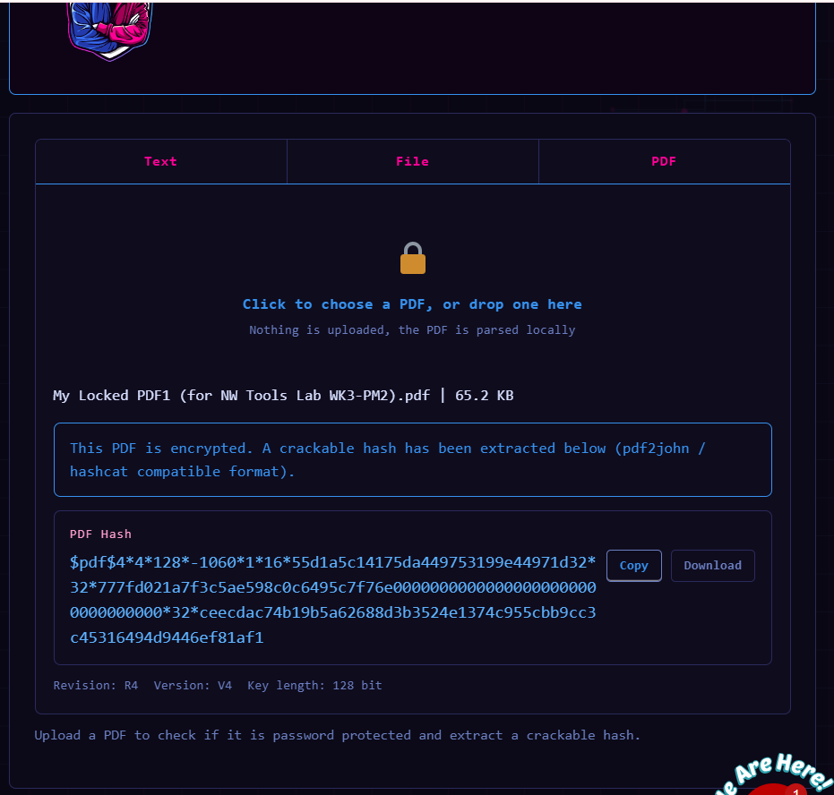

**Step 2 – Crack the hash.** I pasted the hash into the NetworkWalks Password Cracker and started the attack with the built-in 100-password list. The tool tried each password in turn (a dictionary attack) and found a match.

- **Match found at attempt 91/100 → password: `password1`**

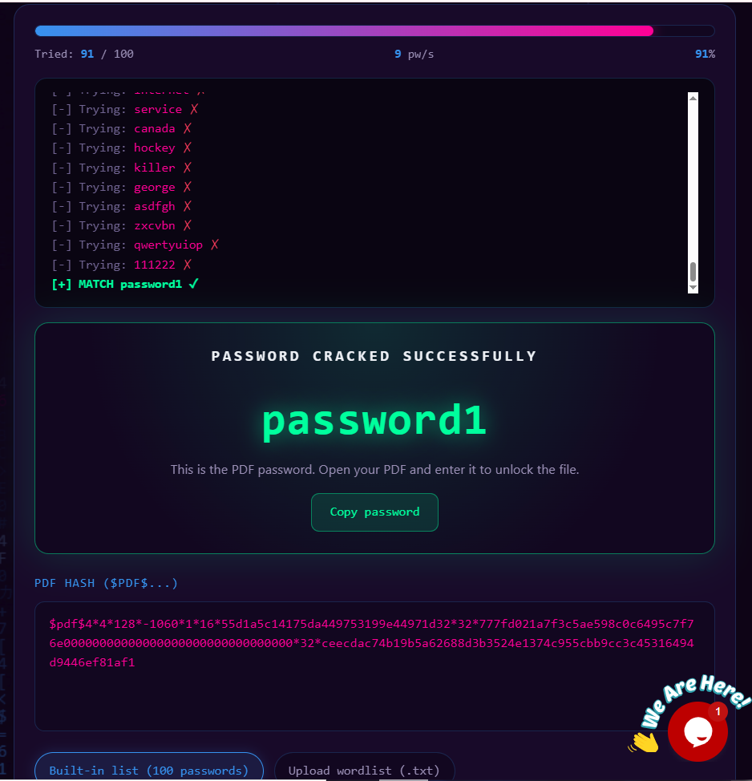

**Step 3 – Open the PDF and capture the flag.** I opened the locked PDF, entered `password1`, and the file unlocked, revealing the flag.

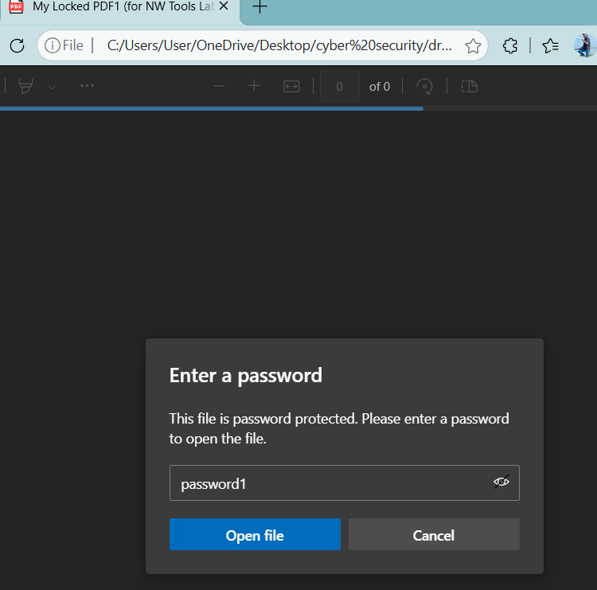

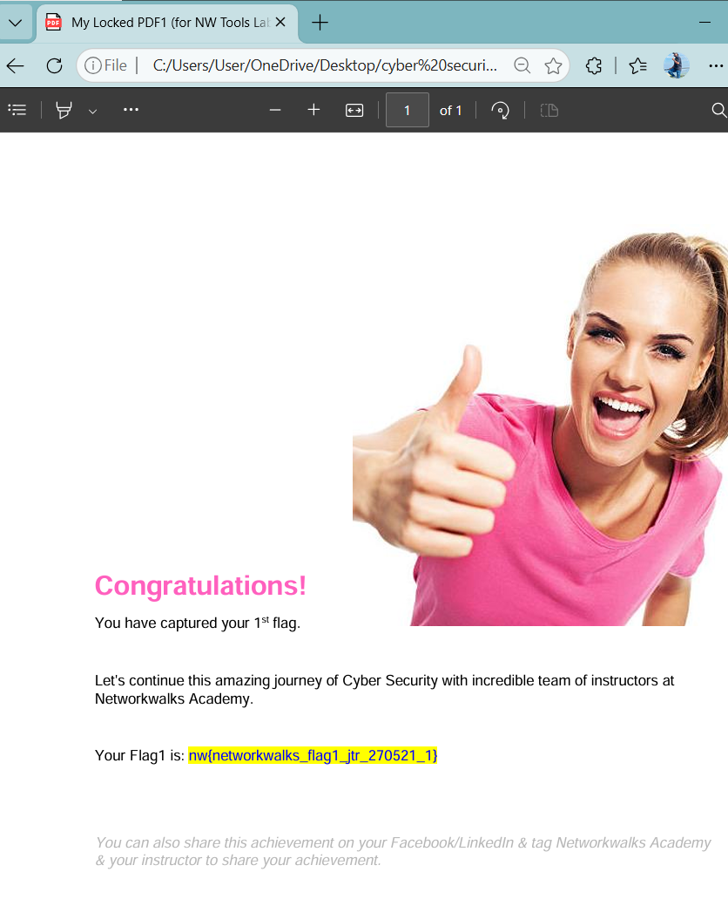

> 🚩 **PM2 Flag:** `nw{networkwalks_flag1_jtr_270521_1}`

### 4.2 W3-PM1 — Password Cracking with John the Ripper

**Step 1 – Extract the hash.** I used the NetworkWalks Hash Calculator again on the PM1 PDF (`My Locked PDF1.pdf`, 266.9 KB) to get its `$pdf$4*4*128*-1028*...` hash, and saved it into a text file (`hash.txt`) in John's `run` folder.

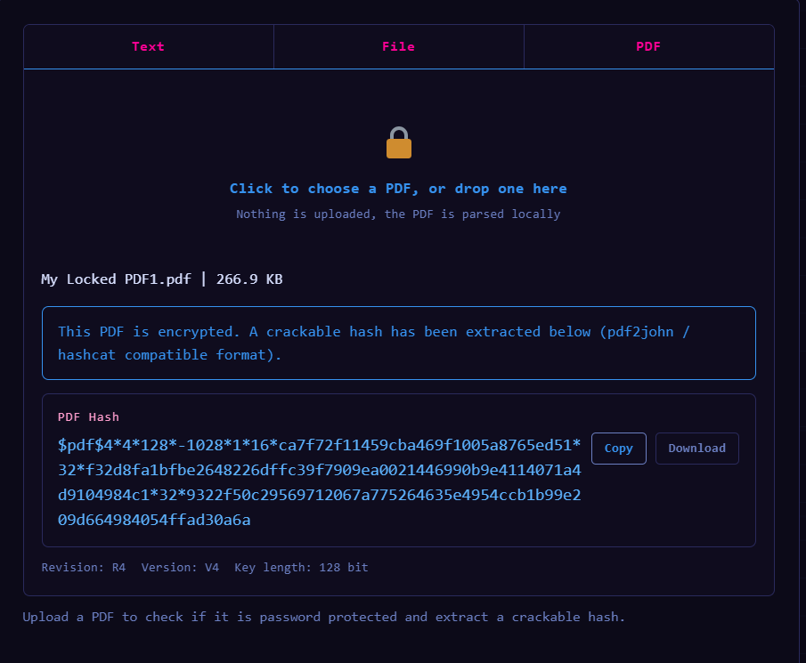

**Step 2 – Prepare the wordlist.** I placed the `rockyou.txt` wordlist in the same `run` folder as `john.exe` and `hash.txt`.

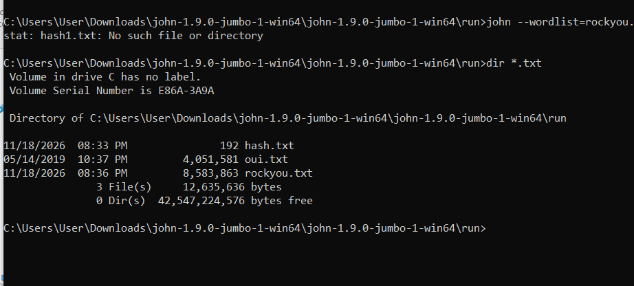

**Step 3 – Run John the Ripper.** From a Command Prompt in the `run` folder I ran:

```bash
john --wordlist=rockyou.txt hash.txt
```

John loaded the hash as **PDF [MD5 SHA2 RC4/AES 32/64]** and ran a dictionary attack using 4 CPU threads.

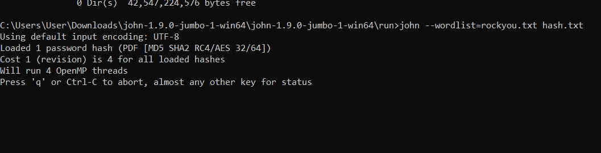

**Step 4 – Password recovered.** John found the password in about 9 seconds.

- **Cracked password: `good-luck`**

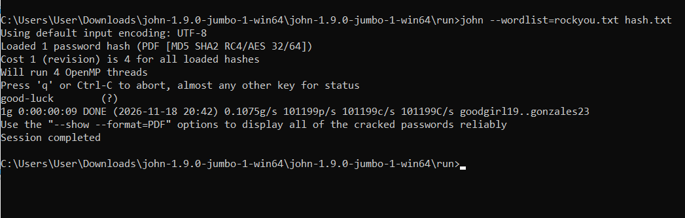

**Step 4b – Johnny GUI.** The task asks to use both **John** and **Johnny** (the GUI front-end of John). I set the John executable path in Johnny's Settings, opened the same `hash.txt`, and Johnny displayed the recovered password `good-luck` for the PDF hash as well (Johnny reads John's results), confirming the crack through both tools.

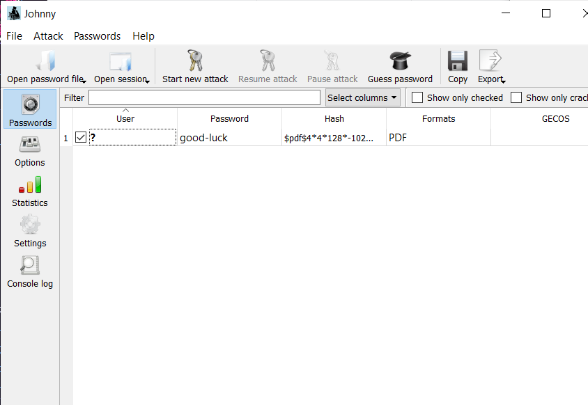

**Step 5 – Open the PDF and capture the flag.** I opened `My Locked PDF1.pdf`, entered `good-luck`, and the file unlocked with the flag.

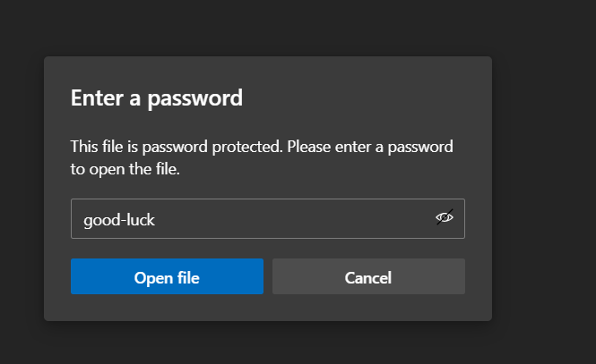

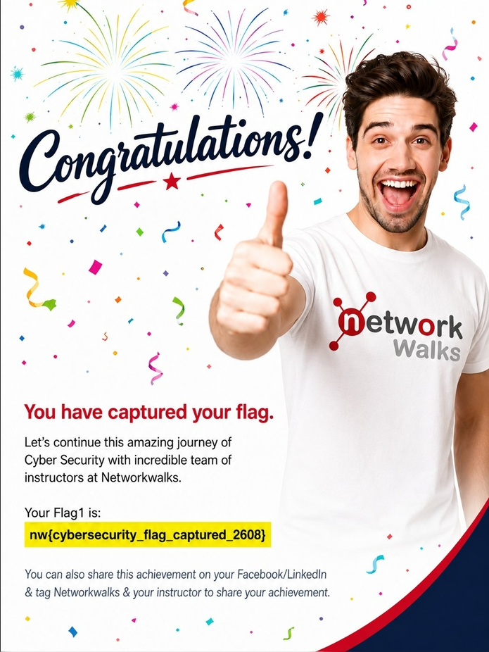

> 🚩 **PM1 Flag:** `nw{cybersecurity_flag_captured_2608}`

---

## 5. Results Summary

| Module | Tool | Attack | Password | Time | Flag |
|---|---|---|---|---|---|
| PM2 | NetworkWalks Password Cracker | Dictionary (built-in 100 list) | `password1` | Seconds (91st word) | `nw{networkwalks_flag1_jtr_270521_1}` |
| PM1 | John the Ripper + rockyou | Dictionary (~14M list) | `good-luck` | ~9 seconds | `nw{cybersecurity_flag_captured_2608}` |

Both passwords were recovered very quickly because they are **weak, dictionary-based passwords**. `password1` is one of the most common passwords in the world, and `good-luck` is a plain dictionary phrase – both appear in public wordlists.

---

## 6. Risk Analysis / Impact

| # | Finding | Evidence | Impact | Risk Level |
|---|---|---|---|---|
| 1 | Weak, common password (`password1`) | Cracked at the 91st word of a 100-word list | A file "protected" by such a password offers almost no protection | 🔴 Critical |
| 2 | Dictionary-word password (`good-luck`) | Found in rockyou.txt and cracked by JTR in ~9 s | Any word or simple phrase in a public wordlist is cracked quickly | 🟠 Medium |
| 3 | Password hash can be extracted from the file | Hash tools produced a `$pdf$...` hash from the PDF | Once a locked file is obtained, cracking can be attempted offline, with no limit on guesses | 🟠 Medium |
| 4 | Leaked wordlists are freely available | rockyou.txt (~14 million passwords) used as the dictionary | Attackers can test millions of real, previously-leaked passwords for free | 🟢 Low |

---

## 7. Recommendations

1. **Use long, strong passwords** – at least 12–16 characters mixing upper- and lower-case letters, numbers and symbols. A strong password is not in any wordlist, so a dictionary attack fails.
2. **Never use common passwords** – avoid `password`, `password1`, `123456`, names, or dictionary words/phrases like `good-luck`.
3. **Use a unique password per file/account** – so one leaked password does not unlock everything.
4. **Use a password manager** – to generate and store strong, random passwords.
5. **Add a second layer where possible** – for example two-factor authentication on accounts, or stronger encryption (AES-256) for very sensitive files.
6. **Only crack files you own or are authorized to test** – password cracking is a security-testing skill and must stay within an authorized scope.

---

## 8. Problems Faced & Solutions

| # | Problem | Cause & Solution |
|---|---|---|
| 1 | NW Password Cracker showed "ACCESS DENIED – not cracked" | I had uploaded the wrong file (the 267 KB PM1 PDF) whose password is not in the 100-word built-in list. For PM2 I used the correct file (`My Locked PDF1 (for NW Tools Lab WK3-PM2).pdf`, 65 KB), and it cracked to `password1`. |
| 2 | Two files both named "My Locked PDF1" | I told them apart by **size**: 267 KB = PM1 (JTR), 65 KB = PM2 (NW Tools). |
| 3 | `john: hash1.txt: No such file or directory` | The hash file was saved on the Desktop / with a different name. I checked the folder with `dir *.txt`, found it was saved as `hash.txt` in the `run` folder, and used that name in the command. |
| 4 | PM1 password was not in the small built-in list | The password (`good-luck`) is deeper in the dictionary, so I used the full **rockyou** wordlist with John, which found it in ~9 seconds. |
| 5 | Johnny GUI setup was fiddly | I ran **John directly from the Command Prompt** (`john --wordlist=rockyou.txt hash.txt`), which is the same engine, faster and clearer than configuring the GUI. |

---

## 9. What I Learned

- **How password cracking actually works:** extract the hash → run a dictionary attack → the tool hashes each guess and compares it to the target hash.
- **Hashing vs encryption:** hashing is one-way, so cracking means guessing, not reversing.
- **Why weak passwords are dangerous:** `password1` and `good-luck` were cracked in seconds because they are in public wordlists.
- **What rockyou.txt is:** a real leaked-password wordlist used by both attackers and defenders.
- **Using John the Ripper:** `pdf2john` to get the hash, `--wordlist` to run a dictionary attack, and `--show` to display the cracked password.
- **The value of careful file handling:** using the right file and the right file name matters, and `dir` helps verify what is actually in a folder.

---

## 10. Conclusion

In Week 3 I recovered the passwords of protected PDF files using two methods – the NetworkWalks online tools and John the Ripper – and captured both flags. The exercise clearly showed how quickly weak, dictionary-based passwords fall to a simple dictionary attack: `password1` and `good-luck` were both broken in seconds.

The most important lesson is defensive: strong, long, unique passwords that do not appear in any wordlist are what actually protect a file or account. I also learned to work carefully (right file, right file name, verifying the folder) and that the command line can be simpler and faster than a GUI. All activities were done only on the training files provided for this lab, on my own laptop.

---

## 11. Evidences Collected

| # | Evidence | File |
|---|---|---|
| 1 | PM2 – Hash Calculator | [screenshot](screenshots/pm2-1-hash-calculator.png) |
| 2 | PM2 – Password cracked (`password1`) | [screenshot](screenshots/pm2-2-password-cracked.png) |
| 3 | PM2 – Enter password | [screenshot](screenshots/pm2-3-enter-password.png) |
| 4 | PM2 – Flag captured | [screenshot](screenshots/pm2-4-flag.png) |
| 5 | PM1 – Hash Calculator (267 KB file) | [screenshot](screenshots/pm1-1-hash-calculator.png) |
| 6 | PM1 – Files in run folder | [screenshot](screenshots/pm1-2-files-dir.png) |
| 7 | PM1 – John the Ripper running | [screenshot](screenshots/pm1-3-john-running.png) |
| 8 | PM1 – Password cracked in John (`good-luck`) | [screenshot](screenshots/pm1-4-john-cracked.png) |
| 9 | PM1 – Password shown in Johnny GUI | [screenshot](screenshots/pm1-7-johnny-cracked.png) |
| 10 | PM1 – Enter password | [screenshot](screenshots/pm1-5-enter-password.png) |
| 11 | PM1 – Flag captured | [screenshot](screenshots/pm1-6-flag.png) |

-End-

---

## 👤 Author

**Azlal Ahamed**\
Cybersecurity Intern – Batch B084C

GitHub: [https://github.com/azlmay](https://github.com/azlmay)

---

## 📌 Project Information

**Program Name:** Cybersecurity program at Networkwalks | **Week:** 03 | **Modules:** W3-PM1, W3-PM2 | **Repository:** GitHub
